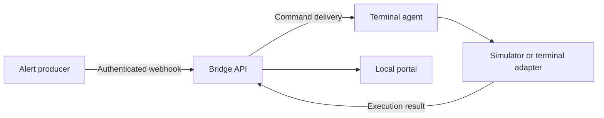

# Independent bridge demo

This project is an original implementation of a generic alert-to-trading-terminal bridge. It uses public protocol concepts and independently designed interfaces. It does not import vendor binaries, decompiled source, constants, credentials, assets, or proprietary message formats.

## Demo contract

1. A local portal shows connections, signals, execution outcomes, and simulated positions.
2. A webhook accepts an authenticated command for a connection.
3. A connected agent receives the command and reports a distinct execution result.
4. The first executor is selected during setup: simulation or explicitly configured demo-account integration.
5. Delivery and execution are separate states. Repeated request identifiers must not duplicate execution.
6. The repository includes reproducible startup instructions, behavioral verification, a file-by-file guide, and GitHub CI.

## Boundaries

The portal is a local development application. Broker execution requires a separate terminal adapter and explicit configuration. A receipt from the webhook must never be presented as a broker fill. The original program's compiled EA internals were not recovered; this implementation does not claim compatibility with its private backend.

## Flow

