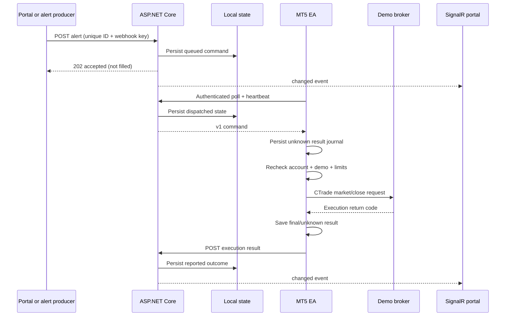

# Architecture and technology choices

## Independent implementation boundary

The earlier analysis established a generic separation between alert routing, network transport, terminal execution and reporting. This project implements that concept from scratch. It does not import or translate the recovered DLL or EX4/EX5 files. The public Microsoft SignalR client and the terminal's standard CTrade library are dependencies with their own licenses.

## Components

ASP.NET Core SignalR is used for the actual live portal connection, including normal negotiation, JSON handshake and reconnection. The MT5 leg uses native WebRequest polling once per second, not SignalR or a DLL. That is a deliberate first-version choice: MQL5 can use its supported HTTP interface without implementing another WebSocket stack or shipping a managed/native bridge. A future companion .NET agent can use an official SignalR client and a local EA IPC layer if lower delivery latency is required.

## HTTP endpoints

| Endpoint | Credentials | Behavior |
|---|---|---|
| GET `/health` | Loopback only | Liveness |
| GET `/api/admin/state` | Admin key | Dashboard snapshot, setup keys and command history |
| POST `/api/admin/resolve/{id}` | Admin key | Explicit operator acknowledgement of an unknown outcome |
| POST `/api/webhook/demo-mt5` | Webhook key in header or JSON secret | Validate, deduplicate and queue a trade instruction |
| GET `/api/terminal/poll` | Terminal key | Bind account/broker, heartbeat, claim at most one command |
| POST `/api/terminal/result` | Terminal key | Idempotently record an execution report |
| `/hub/portal` | Admin bearer token | Real SignalR state-change events |

Keys have different roles. No broker password is requested or stored. Polling's demo flag is metadata; the EA independently checks the terminal's actual account mode before broker calls. The browser token stays in memory. SignalR's WebSocket token can appear in its query string; never log full query strings in a production deployment.

## Delivery and recovery

The durable store is SQLite with settings, commands, receipts and audit tables, WAL mode and FULL synchronization. Receipt and command changes commit together before acknowledgement. Updates are serialized under a lock and applied to the memory cache only after commit. An exclusive lease excludes a second server process using the same directory. Legacy JSON is imported once; see [TRADINGVIEW.md](TRADINGVIEW.md).

Command transitions and account/broker binding remain durable. Heartbeat time, balance, equity and position count are transient snapshots; they are cleared on restart and are not written on every poll. An unchanged dashboard uses the read path. If a queued or dispatched command is overdue, the dashboard first persists its expiry/unknown transition. Transactions clone records in memory and compare durable values, avoiding JSON clone/serialize work and disk writes when only telemetry changes. Saving still happens before a newly queued/dispatched command or execution result is exposed.

Command IDs, broker symbols and account identifiers use absolute allowlist anchors (`\A` and `\z`), so a final LF cannot bypass validation. The EA JSON helper escapes control characters instead of replacing them with spaces; it preserves identifiers and result details.

Up to1000 pending commands can queue in order while offline, paused or blocked by an unresolved outcome. One command may be dispatched at a time; unknown outcomes block further dispatch. IDs remain unique in the database beyond the recent dashboard cache. A repeated ID with matching fields returns its old record; a conflicting reuse returns409, and both attempts have separate receipt records. Commands expire at their persisted deadline (default30seconds), capped by an optional producer timestamp. Dispatch rechecks the symbol/lot policy. Dispatched commands become unknown if overdue or after restart and are not replayed automatically.

The EA saves an unknown outcome before a broker request, then overwrites that record with the observed return code. It sends any outstanding result before collecting another command. A crash between dispatch and saving the result may lose an instruction or leave uncertainty. There is no atomic transaction joining the server disk, terminal disk and broker. An unknown state therefore requires human reconciliation, not a retry loop.

The portal labels are reports from the terminal. They are not independent broker verification. In particular, `closed` can mean there were zero matching positions; the detail says how many were closed. Partial fills, timeout and connection-loss returns remain unknown. A command acknowledgement never substitutes for checking positions/history.

## Trading semantics

Volumes are explicit lots. Targets are distances in broker points, aligned to tick increments. Broker volume minimum, maximum and step and the EA's cap are checked. The broker remains authoritative for quotes, stops, sessions and execution. Entries are rejected if any position already exists on that symbol. Close selects only its symbol and magic on a hedging account. Netting closes are rejected because mixed ownership cannot be represented safely by magic alone.

There is no strategy engine or simulated P&L. The server stores heartbeat balance/equity and total position count as reported. It cannot infer a strategy's returns or all account transactions from those samples.
